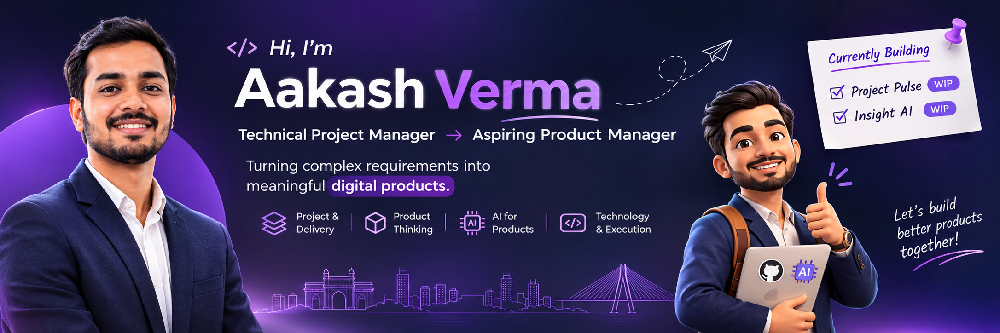

  

# Aakash Verma

### Technical Project Manager | Product Management | AI & Digital Products

**Turning complex requirements into meaningful digital products.**

I work at the intersection of technology, project delivery and product thinking. With a foundation in software engineering and experience coordinating cross-functional teams, I enjoy translating business problems into structured requirements, actionable plans and digital solutions.

I'm currently growing towards Product Management, with a particular interest in AI-powered products, product discovery and intelligent workflows.

📍 Mumbai, India · 🌐 [LinkedIn](https://www.linkedin.com/in/aakashverma23) · ✉️ [Email](mailto\:aakashverma1672@gmail.com)

---

## 👋 A little about me

My journey started with software engineering, where I worked with Java, Spring Boot, REST APIs and databases. Over time, I moved closer to project ownership, client collaboration and product delivery.

Today, my experience spans:

- **Project & Delivery Management:** Coordinating multiple projects, sprint planning, release tracking, stakeholder communication and risk management.
- **Product Thinking:** Supporting discovery, requirements gathering, feature prioritisation, PRD/BRD preparation on selected projects, and product improvement discussions.
- **Technical Foundation:** Understanding software architecture, APIs, databases and engineering workflows.
- **AI & Innovation:** Exploring how generative AI and intelligent automation can improve products, teams and business processes.

A few things I enjoy outside work: sketching, cricket, badminton, carrom, business stories, Hindu mythology and ancient Indian sculpture.

---

## 💼 Professional journey

| Organisation       | Experience                                                                                                                                                                                             |
| ------------------ | ------------------------------------------------------------------------------------------------------------------------------------------------------------------------------------------------------ |
| **ProCreator**     | Coordinated 6–8 concurrent digital projects, working with design, development, QA and operations teams. Supported product discovery, sprint planning, feature prioritisation and release coordination. |
| **SyncEdge**       | Worked on project consulting, client relationships, requirements, planning and delivery coordination for startup engagements.                                                                          |
| **Veena Infotech** | Led technical and project delivery across multiple client accounts and 20+ digital projects.                                                                                                           |
| **Wipro**          | Built my engineering foundation through Java development, Spring Boot, REST APIs, databases and Agile team collaboration.                                                                              |

---

## 🚀 Selected work

### Lottery Allocation Platform

A digital allocation solution designed to improve transparency and streamline the redevelopment allocation process.

- Coordinated requirements and stakeholder discussions.
- Supported testing and multiple UAT rounds.
- Helped reduce a manual process from approximately two days to 3–4 hours.
- Supported a process that completed without allocation disputes.

### Digital Product Delivery

Worked across multiple anonymised client engagements in areas including fintech, mobility, automotive, sports, lending and other digital platforms.

My responsibilities included requirements coordination, design reviews, sprint planning, client communication, prioritisation, release coordination and delivery tracking.

---

## 🧪 Product Lab

I'm building products to strengthen my product thinking and technical capabilities.

| Project           | What I'm exploring                                                                                                     | Status           |
| ----------------- | ---------------------------------------------------------------------------------------------------------------------- | ---------------- |
| **Project Pulse** | Project management and delivery intelligence, including sprint health, risks, team capacity and AI-assisted reporting. | Work in Progress |
| **Insight AI**    | AI-powered product intelligence, user feedback analysis, product metrics and prioritisation insights.                  | Work in Progress |

More details, product documentation and development updates will be published as these projects evolve.

---

## 🛠️ Skills & Tools

**Project & Product Management**

Agile · Scrum · Sprint Planning · Product Discovery · Requirements Gathering · User Stories · Feature Prioritisation · UAT · Stakeholder Management · Risk & Dependency Management · Release Coordination

**Project Management Tools**

Zoho Projects · Zoho Sprints · Jira · Asana · ClickUp

**Engineering Foundation**

Java · Spring Boot · REST APIs · Hibernate · MySQL · SQL · JavaScript · PHP · HTML · CSS

**AI & Productivity**

ChatGPT · Claude · Generative AI Exploration · Prompt Engineering · AI-assisted Workflows

---

## 📚 What I'm learning and building

- AI Product Management and product strategy.
- Product analytics and data-informed decision-making.
- Building practical AI-enabled applications.
- Database design, API architecture and full-stack development.
- Product documentation, experimentation and prioritisation.

---

## 🤝 Let's connect

I'm always interested in conversations around product management, technology, AI, digital transformation and building useful products.

- **LinkedIn:** [Connect with me](https://www.linkedin.com/in/aakashverma23)
- **Email:** [aakashverma1672@gmail.com](mailto\:aakashverma1672@gmail.com)
- **Portfolio:** Coming soon.

---

*Good products don't happen by accident. They're discovered, prioritised, built, tested and improved — one decision at a time.*
